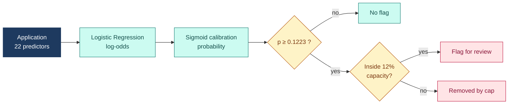
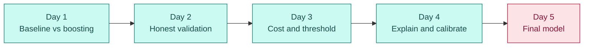
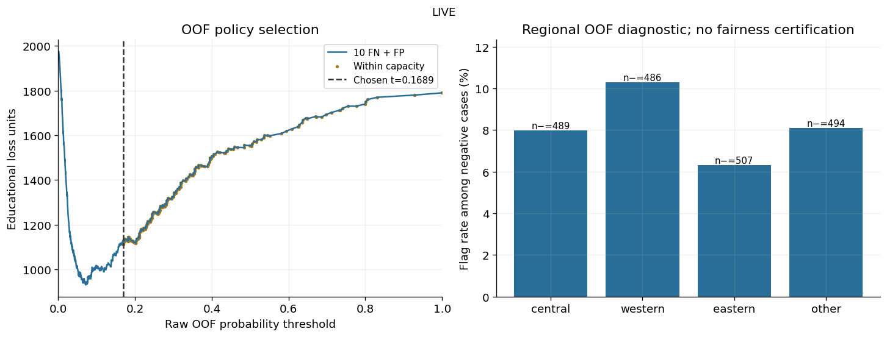

<div align="center">

# Tamweel · Credit Default Risk

### Predicting 90-day default at application time, then turning the probability into a review decision under cost and capacity limits


</div>

> [!IMPORTANT]
> **There is a second branch for the user experience.**
> This `main` branch holds the notebooks, outputs and daily answers.
> The [`website`](https://github.com/USERNAME/REPO/tree/website) branch holds a web app built **only** from the Day 5 output files: an applicant role, and a lender role that traces every decision step by step.
>
> | | Link |
> |---|---|
> | Live site | **(https://hareerfn.github.io/Hareer_Farraj_Tamweel_SDAIA_AdvancedML/#apply)** |
> | Branch code | [`tree/website`](https://github.com/USERNAME/REPO/tree/website) |

> [!WARNING]
> Educational project on **fictional, synthetic** Tamweel Lite data. A flag means *send for review*, not *reject*. Not for real credit decisions.

---

## Contents

| | Section |
|---|---|
| 1 | [The problem in one table](#1-the-problem-in-one-table) |
| 2 | [Final result](#2-final-result) |
| 3 | [The 5-day journey](#3-the-5-day-journey) |
| 4 | [Daily answers](#4-daily-answers) |
| 5 | [Repository structure](#5-repository-structure) |
| 6 | [How to run](#6-how-to-run) |
| 7 | [Limitations](#7-limitations) |

---

## 1. The problem in one table

| Item | Definition |
|---|---|
| **Question** | Can we estimate default risk **before** granting financing? |
| **Target** | `default_within_90d`: `1` = default event within 90 days after application, `0` = no default |
| **Prediction moment** | At application time. Only information known when the request is submitted |
| **Data** | 10,000 training applications · 22 predictors · **7.89%** default rate · 2,500 unlabelled challenge requests |
| **Decision** | Flag for review (`1`) or no flag (`0`) |
| **Cost** | $\text{Loss} = 10 \times FN + 1 \times FP$ (a missed default costs 10 times a false alarm) |
| **Capacity** | At most **12%** of requests can be reviewed |
| **Main metric** | Average Precision (AP), never accuracy |

> [!NOTE]
> **Why never accuracy?** With 7.89% defaults, a model that flags nobody is 92% accurate and catches zero defaulters.

---

## 2. Final result



| Measure | Value | Source file |
|---|---|---|
| Decision | **KEEP SINGLE: Logistic Regression** | [`final_metrics.json`](artifacts/final_metrics.json) |
| Mean AP, 3 forward folds | **0.392** (fold SD 0.030) | [`ensemble_comparison.csv`](artifacts/ensemble_comparison.csv) |
| Best ensemble (Weighted) | 0.389, no gain, so not used | [`ensemble_comparison.csv`](artifacts/ensemble_comparison.csv) |
| Threshold | raw **0.1689**, calibrated **0.1223** | [`final_policy.json`](artifacts/final_policy.json) |
| OOF recall · precision | **46.9% · 34.3%** · loss 1,111 units | [`final_metrics.json`](artifacts/final_metrics.json) |
| Challenge batch | 330 passed the threshold, **300 flagged** (12% cap) | [`submission.csv`](submission/submission.csv) |
| Regional FPR gap | 4.0 percentage points (monitor) | [`day5_region_audit.csv`](artifacts/day5_region_audit.csv) |

<p align="center">
  
</p>

---

## 3. The 5-day journey



| Day | Focus | One-line finding |
|---|---|---|
| [1](#day-1--model-comparison) | Compare 3 models on a random split | Simple Logistic Regression matched the boosted trees |
| [2](#day-2--honest-validation) | Leakage, time order, customer separation | Two leaky fields faked AP 0.999; honest AP is 0.315 |
| [3](#day-3--cost-and-threshold) | Turn scores into decisions | Default 0.5 broke the 12% capacity; a capacity-feasible threshold was chosen |
| [4](#day-4--explain-and-calibrate) | Explain and calibrate | `bureau_score` and `dti` drive risk; sigmoid cut ECE from 0.147 to 0.022 |
| [5](#day-5--final-model) | Final model and policy | No ensemble beat Logistic Regression; 300 of 2,500 flagged |

---

## 4. Daily answers

> [!TIP]
> Each day shows the question, my video answer, the date, the key numbers from my own run, and a link to open the notebook in Colab.

---

### Day 1 · Model comparison


[](https://github.com/HareerFN/Hareer_Farraj_Tamweel_SDAIA_AdvancedML/blob/main/Daily_Submission/Day0%2B1.ipynb)

> **Daily question**
> Which model did you select initially, and what is the strongest result supporting your choice?

**Video answer:** VIDEO_LINK_DAY_1

<details>
<summary><b>Key results from my run</b></summary>

<br>

Random stratified split: 8,000 development rows (6,000 `inner_fit` + 2,000 `inner_stop`) and 2,000 `comparison` rows, 7.9% defaults in each.

| Model | ROC-AUC | AP | Train time | Trees |
|---|---|---|---|---|
| **Logistic Regression** | **0.821** | 0.326 | **0.11 s** | — |
| XGBoost | 0.812 | **0.334** | 1.06 s | 61 |
| LightGBM | 0.814 | 0.325 | 1.13 s | 41 |

- Random baseline for AP = prevalence, **0.079**.
- 1,226 customers appear in both development and comparison, tested on Day 2.

<p align="center"></p>

</details>

---

### Day 2 · Honest validation


[](https://github.com/HareerFN/Hareer_Farraj_Tamweel_SDAIA_AdvancedML/blob/main/Daily_Submission/Day0%2B1%2B2.ipynb)

> **Daily question**
> *Paste the Day 2 question here.*

**Video answer:** VIDEO_LINK_DAY_2

<details>
<summary><b>Key results from my run</b></summary>

<br>

- Removed 2 post-outcome fields: `days_past_due_60` and `collection_calls`.
- 3 forward folds (validation starts 2023-07-01, 2024-01-01, 2024-07-01), mature labels only, **0 shared customers** in every fold.
- Tuning on a separate reserved pool of 1,935 early rows (8 Optuna trials, best search AP 0.333).

| Validation scheme | Rows | ROC-AUC | AP |
|---|---|---|---|
| Leaky random (unsafe) | 10,000 | 0.9999 | 0.999 |
| Clean random (unsafe) | 10,000 | 0.801 | 0.311 |
| **Honest, fixed 80 trees** | **5,039** | **0.798** | **0.315** |
| Honest, tuned | 5,039 | 0.786 | 0.313 |

- Leakage inflated AP by **0.688**.
- Tuning did not beat the fixed model.

<p align="center"></p>

</details>

---

### Day 3 · Cost and threshold


[]
(https://github.com/HareerFN/Hareer_Farraj_Tamweel_SDAIA_AdvancedML/blob/main/Daily_Submission/Day0%2B1%2B2%2B3.ipynb)
> **Daily question**
> *Paste the Day 3 question here.*

**Video answer:** VIDEO_LINK_DAY_3

<details>
<summary><b>Key results from my run</b></summary>

<br>

Weighted strategy, declared before comparison. 5,039 out-of-fold rows. $\text{Loss} = 10 \times FN + FP$.

| Rule | Threshold | Flagged | Recall | Precision | Loss | Within 12%? |
|---|---|---|---|---|---|---|
| Default | 0.500 | 19.9% | 57.8% | 22.1% | 2,403 | No |
| Lowest loss, no capacity limit | 0.449 | 22.6% | 64.1% | 21.6% | 2,275 | No |
| **Chosen** | **0.658** | **10.4%** | **40.9%** | **29.9%** | **2,639** | **Yes** |

- Flags per period: 8.4%, 10.9%, 11.9%, all under 12%.
- Regional FPR gap: 0.65 percentage points.

<p align="center"></p>

</details>

---

### Day 4 · Explain and calibrate


[]
(https://github.com/HareerFN/Hareer_Farraj_Tamweel_SDAIA_AdvancedML/blob/main/Daily_Submission/Day0%2B1%2B2%2B3%2B4.ipynb)

> **Daily question**
> *Paste the Day 4 question here.*

**Video answer:** VIDEO_LINK_DAY_4

<details>
<summary><b>Key results from my run</b></summary>

<br>

LightGBM with time-ordered roles: fit 2,516 · calibration 584 · policy 589 · evaluation 1,733 rows.

| Driver | Permutation AP drop | Mean abs. SHAP (log-odds) |
|---|---|---|
| `bureau_score` | **0.127** | **0.904** |
| `dti` | 0.069 | 0.544 |
| `loan_amount_sar` | 0.014 | 0.349 |

| Probabilities on evaluation | Brier | ECE | AP |
|---|---|---|---|
| Raw | 0.1130 | 0.1469 | 0.259 |
| **Sigmoid calibrated** | **0.0671** | **0.0225** | 0.259 |

- Calibration fixed the probability scale and kept the ranking (AP unchanged).
- Customer-cluster bootstrap 95% range for AP: 0.197 to 0.338.
- Highest-risk case `TR-009585`: raw score 0.903, calibrated 0.480; top reasons `bureau_score = 497` and `dti = 1.28`.
- Policy threshold 0.588 (raw), 0.173 (calibrated). Status: `CAPACITY_REVIEW_REQUIRED`.

<p align="center"></p>
<p align="center"></p>

</details>

---

### Day 5 · Final model


[]
(https://github.com/HareerFN/Hareer_Farraj_Tamweel_SDAIA_AdvancedML/blob/main/Daily_Submission/Day0%2B1%2B2%2B3%2B4%2B5.ipynb)

> **Daily question**
> *Paste the Day 5 question here.*

**Video answer:** VIDEO_LINK_DAY_5

<details>
<summary><b>Key results from my run</b></summary>

<br>

Nested forward OOF on a 6,576-row fit and selection pool; 836 rows held out for calibration only; 2,155 OOF rows in three forward periods.

| Candidate | Mean AP | Fold SD | Brier | ECE | Passes gate |
|---|---|---|---|---|---|
| LightGBM | 0.345 | 0.043 | 0.0661 | 0.0231 | No |
| XGBoost | 0.353 | 0.029 | 0.0657 | 0.0228 | No |
| **Logistic** | **0.392** | **0.030** | **0.0633** | **0.0188** | Baseline |
| Equal | 0.372 | 0.033 | 0.0644 | 0.0204 | No |
| Weighted | 0.389 | 0.029 | 0.0633 | 0.0177 | No |
| Stack | 0.383 | 0.029 | 0.0660 | 0.0311 | No |

Gate: AP lift above one fold SD, Brier increase at most 0.005, ECE increase at most 0.01. No ensemble passed, so the single model was kept.

| Policy | Value |
|---|---|
| Raw OOF threshold | 0.1689 · 245 of 2,155 flagged (11.4%), max 11.7% in any period |
| OOF result | TP 84 · FP 161 · FN 95 · recall 46.9% · precision 34.3% · loss 1,111 |
| FN cost sensitivity | 921 (FN = 8) · 1,111 (FN = 10) · 1,301 (FN = 12) |
| Calibrated threshold | 0.1223 |
| Challenge batch | 2,500 rows · capacity 300 · 330 eligible · **300 flagged** · 30 removed by cap |

| Region | False positive rate | Recall |
|---|---|---|
| Central | 8.0% | 50.0% |
| Western | 10.3% | 44.7% |
| Eastern | 6.3% | 45.7% |
| Other | 8.1% | 46.9% |

> [!CAUTION]
> On the 836 calibration rows the sigmoid did not improve the already well-calibrated Logistic Regression (Brier 0.0765 to 0.0781, ECE 0.0211 to 0.0349). This is a diagnostic on the rows it was fitted on, not an independent test.

<p align="center"></p>
<p align="center"></p>

</details>

---

## 5. Repository structure

```text
REPO/
├── notebooks/
│   ├── 01_baseline_boosting.ipynb        Day 1
│   ├── 02_validation_tuning.ipynb        Day 2
│   ├── 03_cost_sensitive_decision.ipynb  Day 3
│   ├── 04_explain_calibrate.ipynb        Day 4
│   └── 05_final_model.ipynb              Day 5
├── artifacts/
│   ├── final_model/
│   │   ├── model.json                    frozen Logistic Regression + sigmoid
│   │   └── model_manifest.json           sha256 of model.json
│   ├── final_metrics.json                gate, OOF operating point, diagnostics
│   ├── final_policy.json                 threshold, cost, capacity, batch audit
│   ├── ensemble_comparison.csv
│   ├── day5_*.csv / day5_*.json          Day 5 evidence tables
│   └── *.png                             plots from every day
├── data/
│   ├── data_contract.json                features, ranges, leakage fields
│   ├── tamweel_train.csv
│   └── tamweel_challenge.csv
├── reports/
│   ├── MODEL_CARD.md
│   └── ENSEMBLE_DECISION.md
├── scripts/
│   ├── day2_validation.py · day3_decision.py · day4_trust.py · day5_final.py
│   ├── inference.py                      predict(frame) → application_id, probability
│   ├── replay_final.py                   re-predict from the saved model
│   └── rebuild_final.py                  retrain the final model
├── submission/
│   ├── submission.csv                    application_id, probability, decision
│   └── submission_manifest.json
├── presentation/
│   └── final_presentation.pdf
├── requirements-colab.txt
└── README.md
```

---

## 6. How to run

| Day | Notebook | Open |
|---|---|---|
| 1 | Baseline vs boosting | [](https://colab.research.google.com/github/USERNAME/REPO/blob/main/notebooks/01_baseline_boosting.ipynb) |
| 2 | Validation and tuning | [](https://colab.research.google.com/github/USERNAME/REPO/blob/main/notebooks/02_validation_tuning.ipynb) |
| 3 | Cost-sensitive decision | [](https://colab.research.google.com/github/USERNAME/REPO/blob/main/notebooks/03_cost_sensitive_decision.ipynb) |
| 4 | Explain and calibrate | [](https://colab.research.google.com/github/USERNAME/REPO/blob/main/notebooks/04_explain_calibrate.ipynb) |
| 5 | Final model | [](https://colab.research.google.com/github/USERNAME/REPO/blob/main/notebooks/05_final_model.ipynb) |

1. Open a notebook in Colab with the badge.
2. Run the cells from top to bottom. The setup cell downloads and checksum-verifies the course files.
3. Keep `FAST_MODE = True` for a free CPU run (seed 211).

Score new requests with the frozen model:

```python
from inference import predict

predictions = predict(frame)   # columns: application_id, probability
```

Apply the policy only after the full batch is assembled: flag when `probability >= 0.1223`, then keep the highest 12% of the batch.

---

## 7. Limitations

- **Synthetic data.** Results say nothing about real borrowers or regions.
- **Few folds.** Only 3 forward folds with about 180 defaults in total; the fold SD is descriptive, not a significance test.
- **Optimistic OOF.** The same OOF rows chose both the model and the threshold.
- **No challenge labels.** No AP, loss or calibration claim is made for the 2,500 challenge requests.
- **Explanations.** Day 4 SHAP explains the Day 4 LightGBM, not the final Logistic Regression.
- **Regions.** The 4-point FPR gap has no confidence interval and is not a fairness certification.

<div align="center">

**Monitoring per batch:** feature drift (PSI) · threshold vs 12% cap · Brier and ECE once labels mature · FPR and recall per region

</div>
