<div align="center">

# Tamweel · Credit Default Risk

### Predicting 90-day default at application time, then turning the probability into a review decision under cost and capacity limits


</div>

> [!IMPORTANT]
> **There is a second branch for the user experience.**
> This `main` branch holds the notebooks, outputs and stage answers.
> The [`website`](https://github.com/HareerFN/Hareer_Farraj_Tamweel_SDAIA_AdvancedML/tree/website) branch holds a web app built **only** from the Stage 5 output files: an applicant role that fills in the [22 features](#3-feature-guide), and a lender role that traces every decision step by step.
>
> | | Link |
> |---|---|
> | Live site | **[Open the Tamweel web app](https://hareerfn.github.io/Hareer_Farraj_Tamweel_SDAIA_AdvancedML/#apply)** |
> | Branch code | [`tree/website`](https://github.com/HareerFN/Hareer_Farraj_Tamweel_SDAIA_AdvancedML/tree/website) |

> [!WARNING]
> Educational project on **fictional, synthetic** Tamweel Lite data. A flag means *send for review*, not *reject*. Not for real credit decisions.

---

## Contents

| | Section |
|---|---|
| 1 | [The problem in one table](#1-the-problem-in-one-table) |
| 2 | [Data description](#2-data-description) |
| 3 | [Feature guide](#3-feature-guide) |
| 4 | [Final result](#4-final-result) |
| 5 | [The 5-stage journey](#5-the-5-stage-journey) |
| 6 | [Stage answers](#6-stage-answers) |
| 7 | [Repository structure](#7-repository-structure) |
| 8 | [How to run](#8-how-to-run) |
| 9 | [Limitations](#9-limitations) |
| 10 | [Training program reference](#10-training-program-reference) |

---

## 1. The problem in one table

| Item | Definition |
|---|---|
| **Question** | Can we estimate default risk **before** granting financing? |
| **Target** | `default_within_90d`: `1` = default event within 90 days after application, `0` = no default |
| **Prediction moment** | At application time. Only information known when the request is submitted |
| **Decision** | Flag for review (`1`) or no flag (`0`) |
| **Cost** | $\text{Loss} = 10 \times FN + 1 \times FP$ (a missed default costs 10 times a false alarm) |
| **Capacity** | At most **12%** of requests can be reviewed |
| **Main metric** | Average Precision (AP), never accuracy |

> [!NOTE]
> **Why never accuracy?** With 7.89% defaults, a model that flags nobody is 92% accurate and catches zero defaulters. On Stage 3's 5,039 out-of-fold rows, "no flags for anyone" scored 92.4% accuracy and the worst loss of all: 3,840 units.

---

## 2. Data description

| File | Rows | Predictors | Missing feature values | Default rate | Use |
|---|---|---|---|---|---|
| `tamweel_dirty.csv` | 10,000 | 22 + 2 leaky fields | 766 | 7.89% | Stage 2 leakage audit only |
| `tamweel_train.csv` | 10,000 | 22 | 766 | **7.89%** | Training and validation |
| `tamweel_challenge.csv` | 2,500 | 22 | 216 | unknown (no labels) | Final scoring |

| Property | Value |
|---|---|
| Application dates | 2022-01-01 to 2024-12-31 |
| Unit of a row | One financing **application** (`application_id`), not one customer |
| Repeated customers | Yes. The same `customer_id` can apply more than once, so customers must be kept apart across train and validation (Stage 2) |
| Columns excluded from predictors | `application_id`, `customer_id`, `application_date` (metadata), `default_within_90d` (target) |
| Columns dropped as leakage | `days_past_due_60`, `collection_calls` (see [Stage 2](#stage-2--honest-validation)) |
| Duplicates | 0 found |
| Data contract | [`data/data_contract.json`](data/data_contract.json): feature names, ranges, timing of each field |

> [!NOTE]
> Missing values are imputed **inside each training fold only**, so no statistics from validation rows leak into the fitted model.

---

## 3. Feature guide

All 22 predictors are **known on the application date**. This is the same set the applicant fills in on the [website branch](https://github.com/HareerFN/Hareer_Farraj_Tamweel_SDAIA_AdvancedML/tree/website).
The *Risk direction* column shows what the Stage 4 SHAP analysis found. It describes the synthetic data and the Stage 4 LightGBM model, not a causal rule.

<details>
<summary><b>Show all 22 features</b> (click to expand)</summary>

<br>

| Group | Feature | Meaning | Risk direction |
|---|---|---|---|
| **Applicant** | `age` | Applicant age in years | — |
| | `months_employed` | Months in current employment | weak |
| | `residence_years` | Years at current address | — |
| **Income & wealth** | `income_sar` | Monthly income (SAR) | higher value, lower risk |
| | `savings_balance_sar` | Savings balance (SAR) | higher value, lower risk |
| | `salary_transfer` | 1 = salary is transferred to the lender | lower risk when 1 |
| **Request** | `loan_amount_sar` | Requested financing amount (SAR) | higher value, higher risk |
| | `tenor_months` | Requested repayment period (months) | — |
| **Obligations** | `dti` | Debt-to-income ratio **including the proposed installment** | higher value, higher risk · **2nd strongest driver** |
| | `existing_obligations_sar` | Current monthly obligations (SAR) | mixed (shares signal with `dti`) |
| | `utilization_ratio` | Share of available credit already used | weak, higher risk |
| | `num_open_accounts` | Number of open credit accounts | — |
| **Credit bureau** | `bureau_score` | Synthetic credit bureau score at application | lower value, higher risk · **strongest driver** |
| | `credit_history_months` | Length of credit history (months) | — |
| | `prior_defaults` | Number of earlier defaults | higher value, higher risk |
| | `recent_inquiries` | Recent credit inquiries | higher value, higher risk |
| **Region** (one-hot) | `region_central` · `region_western` · `region_eastern` | Applicant region; all 0 = *other* | small, audited for fairness |
| **Employment** (one-hot) | `employment_government` · `employment_private` · `employment_self_employed` | Employer type | — |

</details>

> [!TIP]
> Only `bureau_score` and `dti` clearly matter: removing them drops AP by 0.127 and 0.069. Every other feature drops it by 0.014 or less (Stage 4 permutation test).

---

## 4. Final result

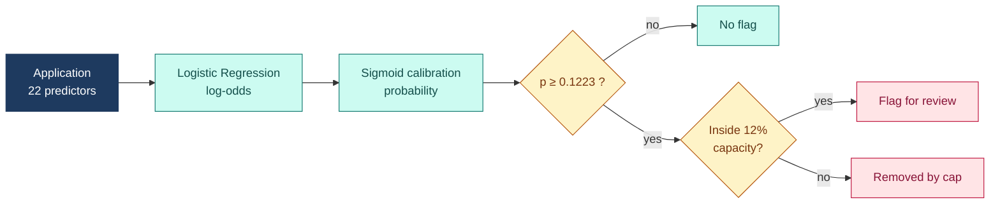

| Measure | Value | Source file |
|---|---|---|
| Decision | **KEEP SINGLE: Logistic Regression** | [`final_metrics.json`](artifacts/final_metrics.json) |
| Mean AP, 3 forward folds | **0.392** (fold SD 0.030) | [`ensemble_comparison.csv`](artifacts/ensemble_comparison.csv) |
| Best ensemble (Weighted) | 0.389, no gain, so not used | [`ensemble_comparison.csv`](artifacts/ensemble_comparison.csv) |
| Threshold | raw **0.1689**, calibrated **0.1223** | [`final_policy.json`](artifacts/final_policy.json) |
| OOF recall · precision | **46.9% · 34.3%** · loss 1,111 units | [`final_metrics.json`](artifacts/final_metrics.json) |
| Challenge batch | 330 passed the threshold, **300 flagged** (12% cap) | [`submission.csv`](submission/submission.csv) |
| Regional FPR gap | 4.0 percentage points (monitor) | [`day5_region_audit.csv`](artifacts/day5_region_audit.csv) |

---

## 5. The 5-stage journey

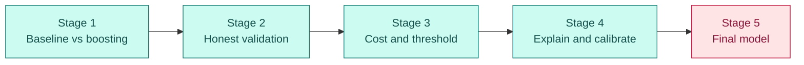

| Stage | Focus | One-line finding |
|---|---|---|
| [1](#stage-1--model-comparison) | Compare 3 models on a random split | Simple Logistic Regression matched the boosted trees |
| [2](#stage-2--honest-validation) | Leakage, time order, customer separation | Two leaky fields faked AP 0.999; honest AP is 0.315 |
| [3](#stage-3--cost-and-threshold) | Turn scores into decisions | Default 0.5 broke the 12% capacity; a capacity-feasible threshold was chosen |
| [4](#stage-4--explain-and-calibrate) | Explain and calibrate | `bureau_score` and `dti` drive risk; sigmoid cut ECE from 0.147 to 0.022 |
| [5](#stage-5--final-model) | Final model and policy | No ensemble beat Logistic Regression; 300 of 2,500 flagged |

---

## 6. Stage answers

> [!TIP]
> Each stage shows the question, my video answer, the date, the key numbers from my own run, the plots with a short reading, and a link to open the notebook in Colab. Extra plots sit under **More plots** in each stage.

---

### Stage 1 · Model comparison


[](https://colab.research.google.com/github/HareerFN/Hareer_Farraj_Tamweel_SDAIA_AdvancedML/blob/main/notebooks/01_baseline_boosting.ipynb)

> **Stage question**
> Which model did you select initially, and what is the strongest result supporting your choice?

**Video answer:** VIDEO_LINK_STAGE_1

<details>
<summary><b>Key results from my run</b></summary>

<br>

Random stratified split: 8,000 development rows (6,000 `inner_fit` + 2,000 `inner_stop`) and 2,000 `comparison` rows, 7.9% defaults in each.

| Model | ROC-AUC | AP | Train time | Trees |
|---|---|---|---|---|
| **Logistic Regression** | **0.821** | 0.326 | **0.11 s** | — |
| XGBoost | 0.812 | **0.334** | 1.06 s | 61 |
| LightGBM | 0.814 | 0.325 | 1.13 s | 41 |

- Random baseline for AP = prevalence, **0.079**.
- 1,226 customers appear in both development and comparison, tested in Stage 2.

<p align="center"></p>
<p align="center"><sub><b>Figure 1.1</b> · ROC-AUC, AP (with 95% bootstrap ranges) and training time for the three models on 2,000 comparison rows.</sub></p>

> **Reading.** The error bars of all three models overlap heavily: the AP ranges span about 0.25 to 0.40, far wider than the 0.008 gap between XGBoost and Logistic Regression. Training time is the only clear difference, with LR about 10 times faster.
> **Conclusion.** No model is reliably better, so the simplest one, Logistic Regression, is the starting candidate.

<p align="center"></p>
<p align="center"><sub><b>Figure 1.2</b> · ROC and precision–recall curves; dotted lines are random ranking and the 7.9% prevalence.</sub></p>

> **Reading.** The ROC curves lie on top of each other. The PR curves show the real difficulty: precision falls below 0.4 once recall passes about 0.3.
> **Conclusion.** About 4 times better than random (AP about 0.33 vs 0.079), but most flags will still be false alarms. That is why Stage 3 prices errors explicitly.

<details>
<summary><b>More plots from Stage 1</b></summary>

<br>

<p align="center">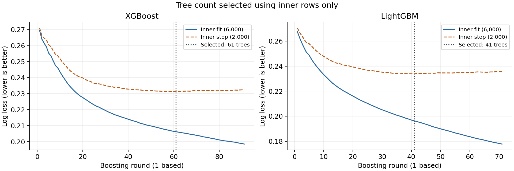</p>
<p align="center"><sub><b>Figure 1.3</b> · Log loss by boosting round on inner-fit (6,000) and inner-stop (2,000) rows; dotted line = selected tree count.</sub></p>

> **Reading.** Training loss keeps falling, but inner-stop loss flattens after about 40 to 60 rounds and then rises slightly. XGBoost stops at 61 trees and LightGBM at 41.
> **Conclusion.** Tree count was chosen on inner rows only, so the comparison set stayed untouched. More trees would only memorise the training data.

</details>

</details>

---

### Stage 2 · Honest validation


[](https://colab.research.google.com/github/HareerFN/Hareer_Farraj_Tamweel_SDAIA_AdvancedML/blob/main/notebooks/02_validation_tuning.ipynb)

> **Stage question**
> *What leakage risk did you identify, and how did the validation design prevent it?.*

**Video answer:** VIDEO_LINK_STAGE_2

<details open>
<summary><b>Key results from my run</b></summary>

<br>

#### 2.1 What leaked: timeline of one application

A field is only usable if it exists **at the decision moment**. Two columns in the dirty file are recorded *after* the loan starts, so they partly *are* the outcome.

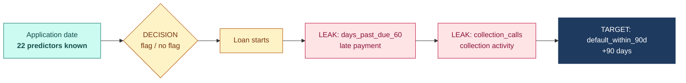

| Field | Available at | Why it leaks | Action |
|---|---|---|---|
| `days_past_due_60` | after application | Late payment is the first step of default | `DROP_POST_OUTCOME` |
| `collection_calls` | after application | Calls start only after missed payments | `DROP_POST_OUTCOME` |
| `application_id`, `customer_id`, `application_date` | application date | Identifiers, not risk signals | excluded as metadata |

#### 2.2 How much leakage lies

| Validation scheme | Leaky fields | Same customer in train and validation | Future rows in training | Rows | ROC-AUC | AP | Verdict |
|---|---|---|---|---|---|---|---|
| Leaky random | kept | yes | yes | 10,000 | 0.9999 | **0.999** | unsafe, fake |
| Clean random | dropped | yes | yes | 10,000 | 0.801 | 0.311 | unsafe |
| **Honest, fixed 80 trees** | dropped | **no** | **no** | **5,039** | **0.798** | **0.315** | **trusted** |
| Honest, tuned | dropped | no | no | 5,039 | 0.786 | 0.313 | trusted |

```text
AP   0.0        0.2        0.4        0.6        0.8        1.0
     |----------|----------|----------|----------|----------|
Leaky random    ██████████████████████████████████████████████████ 0.999  <- fake
Clean random    ███████████████▌                                   0.311
Honest fixed    ███████████████▊                                   0.315  <- trusted
Honest tuned    ███████████████▋                                   0.313
                                 Leakage inflation: +0.688 AP
```

#### 2.3 Honest split design: 3 forward folds

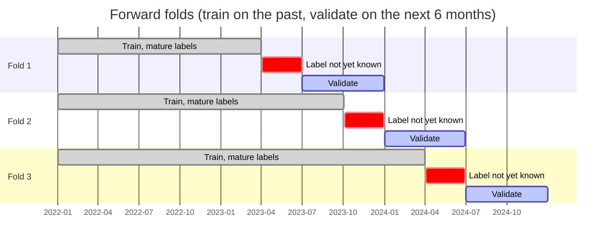

| Fold | Validation window | Train rows | Validation rows | Immature rows removed | Customer-overlap rows removed | Shared customers |
|---|---|---|---|---|---|---|
| 1 | 2023-07 to 2023-12 | 3,223 | 1,632 | 826 | 912 | **0** |
| 2 | 2024-01 to 2024-06 | 4,460 | 1,674 | 785 | 1,348 | **0** |
| 3 | 2024-07 to 2024-12 | 5,731 | 1,733 | 861 | 1,675 | **0** |

- **Label maturity:** a training row is used only if its 90-day outcome was known before validation starts.
- **Customer purge:** customers who appear in the validation window are removed from training.
- **Separate tuning pool:** 1,935 early rows (176 defaults, last date 2023-04-01), 8 Optuna trials, best search AP 0.333. Settings frozen before outer evaluation.
- Tuning did not beat the fixed model (0.313 vs 0.315).

<p align="center"></p>
<p align="center"><sub><b>Figure 2.1</b> · Mean ± sample SD over 3 folds for each validation scheme (not confidence intervals; populations differ).</sub></p>

> **Reading.** The leaky control sits at almost 1.0 on both metrics, which is impossible for real credit data. Once the two fields are dropped, the three clean schemes overlap within their spread (AP 0.311 to 0.315).
> **Conclusion.** Leakage, not the split, was the large error (+0.688 AP). The time and customer protections cost almost nothing here, but they are what make the 0.315 trustworthy.

<p align="center"></p>
<p align="center"><sub><b>Figure 2.2</b> · Training vs validation rows per forward fold after maturity and customer purges.</sub></p>

> **Reading.** Training grows over time (3,223 to 5,731) while each validation window stays about 1,650 rows with about 110 to 140 defaults.
> **Conclusion.** Each fold judges the model on only about 130 defaults, so differences of about 0.03 AP are within noise.

<details>
<summary><b>More plots from Stage 2</b></summary>

<br>

<p align="center"></p>
<p align="center"><sub><b>Figure 2.3</b> · Mean AP of each of the 8 Optuna trials on the reserved tuning pool (search score, not outer performance).</sub></p>

> **Reading.** All 8 trials land between 0.309 and 0.333, a flat line. The best (trial 2) is only 0.025 above the worst, and the smallest internal fold has just 15 defaults.
> **Conclusion.** The search found no clearly better setting, which explains why the tuned model did not beat the fixed 80-tree model on honest folds.

</details>

</details>

---

### Stage 3 · Cost and threshold


[](https://colab.research.google.com/github/HareerFN/Hareer_Farraj_Tamweel_SDAIA_AdvancedML/blob/main/notebooks/03_cost_sensitive_decision.ipynb)

> **Stage question**
> *Why is a fixed threshold of 0.5 not always suitable for this review policy?*

**Video answer:** VIDEO_LINK_STAGE_3

<details>
<summary><b>Key results from my run</b></summary>

<br>

Weighted strategy, declared before comparison. 5,039 out-of-fold rows. $\text{Loss} = 10 \times FN + FP$.

| Rule | Threshold | Flagged | Recall | Precision | Loss | Within 12%? |
|---|---|---|---|---|---|---|
| No flags for anyone | — | 0% | 0% | — | 3,840 | Yes |
| Default | 0.500 | 19.9% | 57.8% | 22.1% | 2,403 | No |
| Lowest loss, no capacity limit | 0.449 | 22.6% | 64.1% | 21.6% | 2,275 | No |
| **Chosen** | **0.658** | **10.4%** | **40.9%** | **29.9%** | **2,639** | **Yes** |

- Flags per period: 8.4%, 10.9%, 11.9%, all under 12%.
- Respecting capacity costs +236 loss units compared with the 0.5 default.
- Regional FPR gap: 0.65 percentage points.

<p align="center">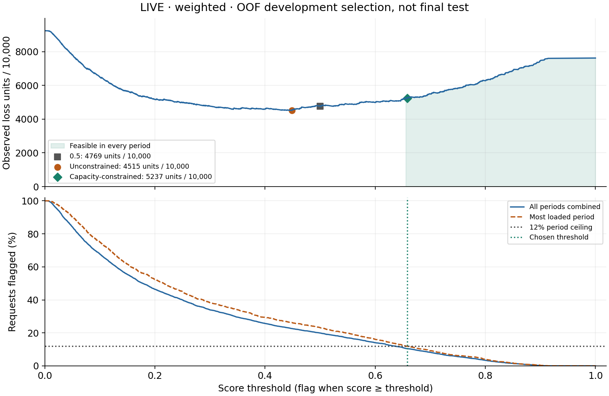</p>
<p align="center"><sub><b>Figure 3.1</b> · Top: loss per 10,000 requests by threshold (green = feasible in every period). Bottom: share flagged, with the 12% ceiling.</sub></p>

> **Reading.** Loss is lowest near 0.45, but at that point about 23% of requests are flagged, almost double the capacity. The flag curve for the busiest period crosses 12% only at about 0.66.
> **Conclusion.** Capacity, not cost, sets the threshold. 0.658 is the cheapest rule the review team can actually handle.

<p align="center"></p>
<p align="center"><sub><b>Figure 3.2</b> · Left: flags vs capacity per period. Right: false positive rate by region.</sub></p>

> **Reading.** Every period stays under its cap, with period 3 nearly full (206 of 207). Regional FPRs range from 7.6% to 8.3%.
> **Conclusion.** The rule is feasible with little headroom, and no region is visibly over-flagged at this stage.

<details>
<summary><b>More plots from Stage 3</b></summary>

<br>

<p align="center"></p>
<p align="center"><sub><b>Figure 3.3</b> · Pooled out-of-fold ROC and PR curves on 5,039 requests for unweighted, weighted and oversampled training.</sub></p>

> **Reading.** The three curves are practically identical (ROC-AUC 0.797 to 0.798, AP 0.309 to 0.316). Weighting and oversampling do not improve the ranking; they only shift scores upward.
> **Conclusion.** Imbalance handling changes *where* the threshold must be, not *how well* the model ranks. The decision comes from the threshold, not the resampling.

</details>

</details>

---

### Stage 4 · Explain and calibrate


[](https://colab.research.google.com/github/HareerFN/Hareer_Farraj_Tamweel_SDAIA_AdvancedML/blob/main/notebooks/04_explain_calibrate.ipynb)

> **Stage question**
> *Which feature was most important in your explanation, and why does that not prove causality?*

**Video answer:** VIDEO_LINK_STAGE_4

<details>
<summary><b>Key results from my run</b></summary>

<br>

LightGBM with time-ordered roles: fit 2,516 · calibration 584 · policy 589 · evaluation 1,733 rows.

| Driver | Permutation AP drop | Mean abs. SHAP (log-odds) |
|---|---|---|
| `bureau_score` | **0.127** | **0.904** |
| `dti` | 0.069 | 0.544 |
| `loan_amount_sar` | 0.014 | 0.349 |

| Probabilities on evaluation | Brier | ECE | AP |
|---|---|---|---|
| Raw | 0.1130 | 0.1469 | 0.259 |
| **Sigmoid calibrated** | **0.0671** | **0.0225** | 0.259 |

- Calibration fixed the probability scale and kept the ranking (AP unchanged).
- Customer-cluster bootstrap 95% range for AP: 0.197 to 0.338.
- Highest-risk case `TR-009585`: raw score 0.903, calibrated 0.480; top reasons `bureau_score = 497` and `dti = 1.28`.
- Policy threshold 0.588 (raw), 0.173 (calibrated). Status: `CAPACITY_REVIEW_REQUIRED` (2024Q4 exceeded its cap).

<p align="center">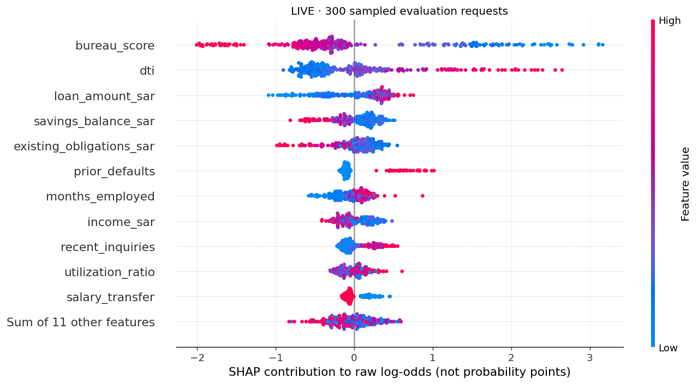</p>
<p align="center"><sub><b>Figure 4.1</b> · SHAP contribution to raw log-odds for 300 evaluation requests; red = high feature value, blue = low.</sub></p>

> **Reading.** A low `bureau_score` (blue) pushes risk up by as much as +3 log-odds, and a high `dti` (red) pushes it up by as much as +2.5. Prior defaults and recent inquiries add risk. A salary transfer and higher savings lower it.
> **Conclusion.** The model follows credit logic, driven by two features: *score* and *affordability*.

<p align="center">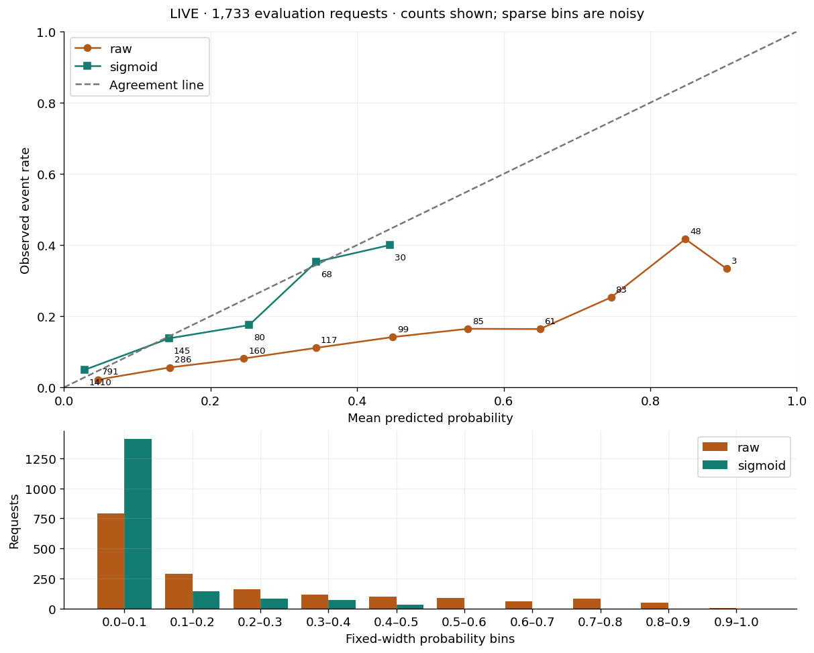</p>
<p align="center"><sub><b>Figure 4.2</b> · Reliability curve on 1,733 evaluation requests; dashed line = perfect calibration; numbers = rows per bin.</sub></p>

> **Reading.** Raw scores sit far below the diagonal. A raw score of 0.65 corresponds to only about 16% observed defaults, because of class weighting. The sigmoid curve follows the diagonal.
> **Conclusion.** Raw weighted scores are rankings, not probabilities. Calibration cut ECE from 0.147 to 0.022 without changing AP.

<details>
<summary><b>More plots from Stage 4</b></summary>

<br>

<p align="center"></p>
<p align="center"><sub><b>Figure 4.3</b> · Left: training split gain. Right: drop in held-out AP when each feature is shuffled (whiskers = repeat SD).</sub></p>

> **Reading.** Both views put `bureau_score` and `dti` far ahead. Gain also ranks `existing_obligations_sar` and `months_employed` high, but shuffling them barely changes held-out AP.
> **Conclusion.** Training gain overstates features that share signal with `dti`. Held-out AP drop is the more honest measure: two features carry the model.

<p align="center">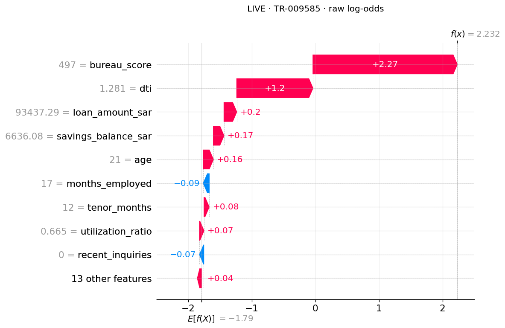</p>
<p align="center"><sub><b>Figure 4.4</b> · SHAP waterfall for the highest-risk case <code>TR-009585</code>, from the average log-odds (−1.79) to this applicant (2.23).</sub></p>

> **Reading.** `bureau_score = 497` adds +2.27 and `dti = 1.28` adds +1.20. Together these two make up almost all of the jump. Every other feature moves the score by 0.2 or less.
> **Conclusion.** One applicant's flag can be explained in plain words: a very low credit score plus debts above income. This is the reason shown to the lender on the website.

<p align="center"></p>
<p align="center"><sub><b>Figure 4.5</b> · 200 customer-cluster bootstrap replicates. Left: AP range raw vs sigmoid. Right: change in Brier after calibration.</sub></p>

> **Reading.** AP spans 0.197 to 0.338 and is identical for raw and sigmoid. Every one of the 200 Brier changes is negative (about −0.057 to −0.035).
> **Conclusion.** The calibration improvement is consistent, not luck. The wide AP range is a reminder that the evaluation has only 139 defaults.

<p align="center"></p>
<p align="center"><sub><b>Figure 4.6</b> · Left: sigmoid mapping from raw score to probability, with the 0.588 raw / 0.173 calibrated threshold. Right: flags vs the 12% limit per quarter.</sub></p>

> **Reading.** 2024Q3 stays under its limit (97 of 100), but 2024Q4 goes over (109 vs 107). Adding near-threshold cases exceeds the limit in both quarters.
> **Conclusion.** A threshold fixed on earlier data can break capacity later, so the status is `CAPACITY_REVIEW_REQUIRED`. Stage 5 fixes this with a hard batch cap.

</details>

</details>

---

### Stage 5 · Final model


[](https://colab.research.google.com/github/HareerFN/Hareer_Farraj_Tamweel_SDAIA_AdvancedML/blob/main/notebooks/05_final_model.ipynb)

> **Stage question**
> *Why did you choose the single model or the ensemble for the final project?*

**Video answer:** VIDEO_LINK_STAGE_5

<details>
<summary><b>Key results from my run</b></summary>

<br>

Nested forward OOF on a 6,576-row fit and selection pool; 836 rows held out for calibration only; 2,155 OOF rows in three forward periods.

| Candidate | Mean AP | Fold SD | Brier | ECE | Passes gate |
|---|---|---|---|---|---|
| LightGBM | 0.345 | 0.043 | 0.0661 | 0.0231 | No |
| XGBoost | 0.353 | 0.029 | 0.0657 | 0.0228 | No |
| **Logistic** | **0.392** | **0.030** | **0.0633** | **0.0188** | Baseline |
| Equal | 0.372 | 0.033 | 0.0644 | 0.0204 | No |
| Weighted | 0.389 | 0.029 | 0.0633 | 0.0177 | No |
| Stack | 0.383 | 0.029 | 0.0660 | 0.0311 | No |

Gate: AP lift above one fold SD, Brier increase at most 0.005, ECE increase at most 0.01. No ensemble passed, so the single model was kept.

| Policy | Value |
|---|---|
| Raw OOF threshold | 0.1689 · 245 of 2,155 flagged (11.4%), max 11.7% in any period |
| OOF result | TP 84 · FP 161 · FN 95 · recall 46.9% · precision 34.3% · loss 1,111 |
| FN cost sensitivity | 921 (FN = 8) · 1,111 (FN = 10) · 1,301 (FN = 12) |
| Calibrated threshold | 0.1223 |
| Challenge batch | 2,500 rows · capacity 300 · 330 eligible · **300 flagged** · 30 removed by cap · boundary score 0.1299 |

| Region | False positive rate | Recall |
|---|---|---|
| Central | 8.0% | 50.0% |
| Western | 10.3% | 44.7% |
| Eastern | 6.3% | 45.7% |
| Other | 8.1% | 46.9% |

> [!CAUTION]
> On the 836 calibration rows the sigmoid did not improve the already well-calibrated Logistic Regression (Brier 0.0765 to 0.0781, ECE 0.0211 to 0.0349). This is a diagnostic on the rows it was fitted on, not an independent test.

<p align="center">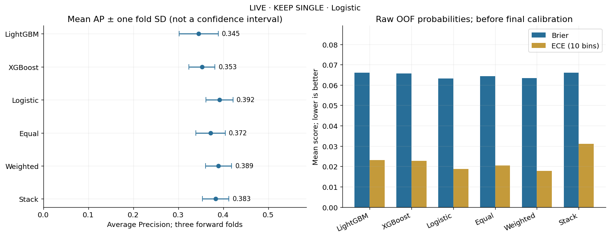</p>
<p align="center"><sub><b>Figure 5.1</b> · Left: mean AP ± one fold SD for 3 single models and 3 ensembles. Right: Brier and ECE of raw OOF probabilities.</sub></p>

> **Reading.** Logistic Regression has the highest AP (0.392) and the joint-lowest Brier. The best ensemble (Weighted, 0.389) is 0.002 lower, well inside one fold SD.
> **Conclusion.** Ensembling adds complexity with no measurable gain, so the single Logistic Regression is kept.

<p align="center"></p>
<p align="center"><sub><b>Figure 5.2</b> · Left: OOF loss vs raw threshold, with the chosen t = 0.1689. Right: false positive rate by region.</sub></p>

> **Reading.** Loss is lowest near 0.07, but there far more than 12% would be flagged. The chosen 0.1689 is the lowest-loss threshold that stays within capacity. Western applicants receive false flags most often (10.3%), Eastern least (6.3%).
> **Conclusion.** The policy is capacity-bound again. The 4.0-point FPR gap is not a fairness verdict, but it should be monitored.

<p align="center">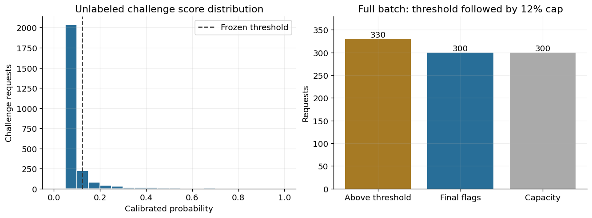</p>
<p align="center"><sub><b>Figure 5.3</b> · Left: calibrated scores of the 2,500 unlabelled challenge requests, with the frozen threshold. Right: threshold first, then the 12% cap.</sub></p>

> **Reading.** Most requests score below 0.1. 330 pass 0.1223, and the cap keeps the 300 highest (boundary score 0.1299).
> **Conclusion.** The frozen policy transfers to new data without retuning, and the cap actually binds (30 removed).

<details>
<summary><b>More plots from Stage 5</b></summary>

<br>

<p align="center">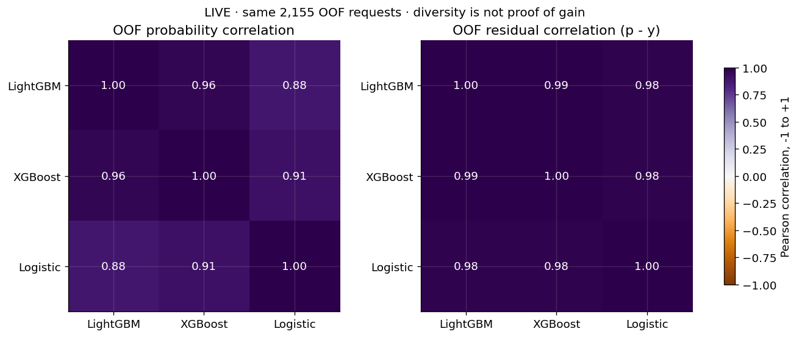</p>
<p align="center"><sub><b>Figure 5.4</b> · Pearson correlation between the three models on the same 2,155 OOF requests. Left: probabilities. Right: errors (p − y).</sub></p>

> **Reading.** Probabilities correlate 0.88 to 0.96, and errors correlate 0.98 to 0.99. The three models make almost the same mistakes on the same applicants.
> **Conclusion.** Ensembles gain from models that disagree. With errors this alike there is nothing to average out, which explains why no ensemble passed the gate.

<p align="center">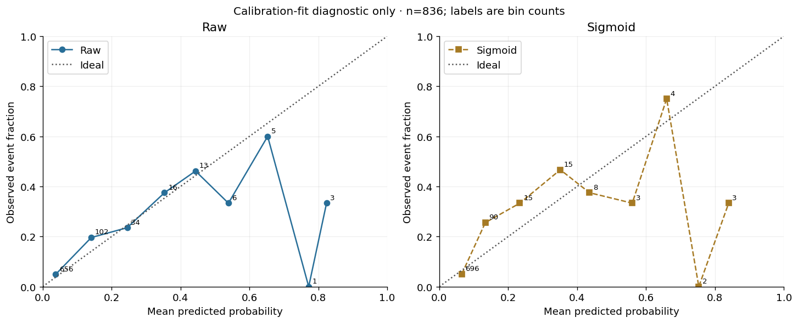</p>
<p align="center"><sub><b>Figure 5.5</b> · Reliability on the 836 calibration rows, raw vs sigmoid; labels = rows per bin.</sub></p>

> **Reading.** Raw Logistic Regression already follows the diagonal where most rows are (656 below 0.1, 102 near 0.15). Above 0.5 the bins hold 1 to 6 rows, so their swings are noise.
> **Conclusion.** Logistic Regression was already well calibrated, so the sigmoid adds little. It is kept as a frozen, consistent step, and this check is on its own fitting rows, not a test.

</details>

</details>

---

## 7. Repository structure

```text
Hareer_Farraj_Tamweel_SDAIA_AdvancedML/
├── notebooks/
│   ├── 01_baseline_boosting.ipynb        Stage 1
│   ├── 02_validation_tuning.ipynb        Stage 2
│   ├── 03_cost_sensitive_decision.ipynb  Stage 3
│   ├── 04_explain_calibrate.ipynb        Stage 4
│   └── 05_final_model.ipynb              Stage 5
├── artifacts/
│   ├── final_model/
│   │   ├── model.json                    frozen Logistic Regression + sigmoid
│   │   └── model_manifest.json           sha256 of model.json
│   ├── final_metrics.json                gate, OOF operating point, diagnostics
│   ├── final_policy.json                 threshold, cost, capacity, batch audit
│   ├── ensemble_comparison.csv
│   ├── day5_*.csv / day5_*.json          Stage 5 evidence tables
│   └── *.png                             20 plots from every stage
├── data/
│   ├── data_contract.json                features, ranges, leakage fields
│   ├── tamweel_train.csv
│   └── tamweel_challenge.csv
├── reports/
│   ├── MODEL_CARD.md
│   └── ENSEMBLE_DECISION.md
├── scripts/
│   ├── day2_validation.py · day3_decision.py · day4_trust.py · day5_final.py
│   ├── inference.py                      predict(frame) -> application_id, probability
│   ├── replay_final.py                   re-predict from the saved model
│   └── rebuild_final.py                  retrain the final model
├── submission/
│   ├── submission.csv                    application_id, probability, decision
│   └── submission_manifest.json
├── presentation/
│   └── final_presentation.pdf
├── requirements-colab.txt
└── README.md
```


---

## 8. How to run

| Stage | Notebook | Open |
|---|---|---|
| 1 | Baseline vs boosting | [](https://colab.research.google.com/github/HareerFN/Hareer_Farraj_Tamweel_SDAIA_AdvancedML/blob/main/notebooks/01_baseline_boosting.ipynb) |
| 2 | Validation and tuning | [](https://colab.research.google.com/github/HareerFN/Hareer_Farraj_Tamweel_SDAIA_AdvancedML/blob/main/notebooks/02_validation_tuning.ipynb) |
| 3 | Cost-sensitive decision | [](https://colab.research.google.com/github/HareerFN/Hareer_Farraj_Tamweel_SDAIA_AdvancedML/blob/main/notebooks/03_cost_sensitive_decision.ipynb) |
| 4 | Explain and calibrate | [](https://colab.research.google.com/github/HareerFN/Hareer_Farraj_Tamweel_SDAIA_AdvancedML/blob/main/notebooks/04_explain_calibrate.ipynb) |
| 5 | Final model | [](https://colab.research.google.com/github/HareerFN/Hareer_Farraj_Tamweel_SDAIA_AdvancedML/blob/main/notebooks/05_final_model.ipynb) |

1. Open a notebook in Colab with the badge.
2. Run the cells from top to bottom. The setup cell downloads and checksum-verifies the course files.
3. Keep `FAST_MODE = True` for a free CPU run (seed 211).

Score new requests with the frozen model:

```python
from inference import predict

predictions = predict(frame)   # columns: application_id, probability
```

Apply the policy only after the full batch is assembled: flag when `probability >= 0.1223`, then keep the highest 12% of the batch.

---

## 9. Limitations

- **Synthetic data.** Results say nothing about real borrowers or regions.
- **Few folds.** Only 3 forward folds with about 180 defaults in total; the fold SD is descriptive, not a significance test.
- **Optimistic OOF.** The same OOF rows chose both the model and the threshold.
- **No challenge labels.** No AP, loss or calibration claim is made for the 2,500 challenge requests.
- **Explanations.** Stage 4 SHAP explains the Stage 4 LightGBM, not the final Logistic Regression.
- **Regions.** The 4-point FPR gap has no confidence interval and is not a fairness certification.

<div align="center">

**Monitoring per batch:** feature drift (PSI) · threshold vs 12% cap · Brier and ECE once labels mature · FPR and recall per region

</div>

---

## 10. Training program reference

| | |
|---|---|
| **Program** | **Advanced ML Application** |
| **Provider** | SDAIA Academy (Saudi Data & AI Authority) |
| **Training program repository** | [github.com/SDAIAAcademy](https://github.com/SDAIAAcademy) |
| **Author** | Hareer Farraj - 7reerfn@gmail.com |

<div align="center">
<sub>Built as part of the SDAIA Academy <b>Advanced ML Application</b> program · synthetic data · educational use only</sub>
</div>
